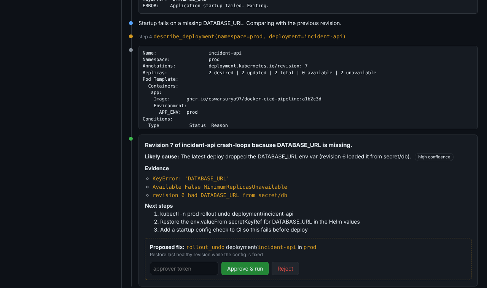

# aiops-triage-agent

**An AI on-call assistant for Kubernetes.** When Prometheus fires an alert, a Claude agent investigates the cluster with **read-only** tools: pods, events, crashed-container logs, rollout history and PromQL. You watch it think **live** in the browser. It finishes with a root cause, evidence and next steps, posts them to Slack, and can **propose** a safe fix. Nothing changes until a human clicks **Approve**.




## Try it in 30 seconds (no cluster needed)

```bash
pip install -r requirements.txt
ANTHROPIC_API_KEY=sk-ant-... python -m triage.demo     # real Claude investigates a simulated broken cluster
# or, with no key:
python -m triage.demo --replay                          # scripted replay, clearly labelled as such
# open http://localhost:8080   approver token: demo
```

The simulated cluster has a classic bad release: revision 7 dropped `DATABASE_URL`, so the pods crash-loop. The agent finds the `KeyError` in the previous container's logs, links it to the new ReplicaSet, and proposes `rollout undo`.

## Architecture

```
 Prometheus ──alert──► Alertmanager ──webhook (Bearer token)──► POST /alertmanager ──202──►
                                                                       │ dedupe by fingerprint (15 min)
                                                                       ▼
                                          ┌──────── Claude tool-use loop (max 8 steps) ────────┐
                                          │  get_pods · get_events · get_pod_logs(previous)    │
                                          │  describe_deployment · prometheus_query            │
                                          │  → must finish with submit_diagnosis (JSON schema) │
                                          └───────────────┬──────────────────┬─────────────────┘
                                         every step (SSE) │                  │ diagnosis
                                                          ▼                  ▼
                                               Live dashboard  ◄──────►  Slack (Block Kit)
                                                          │
                                       human: Approve ────┘──► rollout undo / restart / scale
                                                               (separate, namespace-scoped RBAC)
```

## Guardrails

Getting these right is the hard part of putting an AI agent anywhere near production:

| Risk | Control |
|---|---|
| The AI changes the cluster | Tools are **read-only by code and by RBAC** (`triage-reader` has get/list only, no secrets, no exec). |
| A proposed fix is dangerous | Fixes come from an **allow-list** (restart, undo, scale 1–10), are validated twice, run only on a **human click** with a token, and use a separate **namespace-scoped** Role. |
| Approvals left open by mistake | **Fail closed**: with no `APPROVER_TOKEN` set, approve returns 403. |
| Prompt or command injection | Every argument is checked against the Kubernetes name regex, `kubectl` runs **without a shell**, and unknown tools are rejected. |
| Secrets leak to the LLM or Slack | Tool output is **redacted** (tokens, keys, URL passwords, PEM) and truncated. |
| Runaway cost or loops | Step limit (8), output caps, alert **dedupe**, and Haiku by default. |
| A confident wrong answer | The answer must quote evidence and give a confidence level. A step-limit stop reports "inconclusive" honestly. The UI and Slack say "verify before acting". |

19 tests cover these guardrails, the agent loop, SSE streaming, and the approval flow, including fail-closed behaviour and double-approve protection.

## Run it on a real cluster

Use it with **k8s-gitops-platform**:

```bash
kubectl apply -f deploy/rbac.yaml -f deploy/deployment.yaml   # after creating the secret (see file)
# add deploy/alertmanager-receiver.yaml to the monitoring values, then:
NS=incident-api-dev DEPLOY=incident-api-dev ./scripts/break-it.sh
kubectl -n aiops port-forward svc/aiops-triage 8080:80        # watch it investigate live
```

## Tech

Python 3.12 · FastAPI · Server-Sent Events · Claude Messages API (tool use, forced structured output) · kubectl · Prometheus HTTP API · Slack Block Kit · Kubernetes RBAC · Docker · GitHub Actions

## What I'd add next

- A Redis-backed store for multiple replicas, and an incident history page.
- Runbook retrieval: feed the matching runbook from git into the prompt.
- Evals: a set of recorded broken-cluster scenarios that score the agent's diagnosis accuracy in CI.
