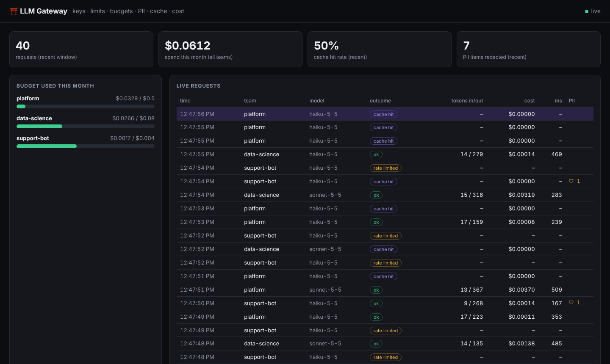

# llm-gateway

**One controlled door between your company and the Claude API.** Teams point the Anthropic SDK at the gateway with their own team key, and the gateway handles what platform teams worry about once LLM usage takes off: **who** is calling, **which models** they may use, **how fast**, **how much they're spending**, **what personal data leaves the building**, and **not paying twice** for the same answer.




## Using it (for a team)

No code changes beyond the base URL and key:

```python
import anthropic

client = anthropic.Anthropic(base_url="https://llm-gateway.internal", api_key="gw-platform-…")  # team key
client.messages.create(model="claude-haiku-5-5", max_tokens=300, messages=[{"role": "user", "content": "…"}])
```

## What happens on every request

```
 team SDK ──x-api-key: gw-team-…──► llm-gateway ───────────────────────────────────────► Claude API
                                     1. auth: SHA-256 hashed team keys (constant-time compare)     (company key,
                                     2. model allow-list per team ............ 403                  never shared)
                                     3. token-bucket rate limit .............. 429 + retry-after
                                     4. monthly budget (USD) ................. 429
                                     5. PII redaction: email, IE phone, PPSN, IBAN, Luhn-valid cards
                                     6. cache (temperature 0, per team, TTL + LRU) ── HIT: $0
                                     7. upstream call, retries on 429/5xx/529 with backoff + jitter
                                     8. meter tokens → USD (incl. long-context tier) → budget, metrics
                                     9. live dashboard (SSE) + Prometheus /metrics
```

Errors use **the Anthropic error format**, so the SDK's own retry and error handling works unchanged.

## Try it (no API key needed)

```bash
pip install -r requirements.txt
python scripts/demo.py          # mock upstream + simulated traffic from 3 teams
open "http://localhost:8070/?token=demo"
```

Within a minute you'll see cache hits, the support bot being **rate-limited**, phone numbers, emails and IBANs being **redacted**, and budgets filling up. The demo's upstream is a mock (every response id starts `msg_mock_`). Costs are calculated from real per-token prices applied to simulated token counts.

Real use: `python -m gateway.keygen platform` makes a team key, then fill in `gateway.yaml` from `gateway.example.yaml` and run `ANTHROPIC_API_KEY=… uvicorn gateway.app:app`.

## Metrics

`gateway_requests_total{team,model,outcome}` · `gateway_tokens_total{direction}` · `gateway_cost_usd_total{team,model}` · `gateway_cache_saved_usd_total{team}` · `gateway_pii_redactions_total{kind}` · `gateway_upstream_latency_seconds`

These map straight onto Grafana panels such as "spend by team this month", "cache savings" and "p95 latency by model", and onto alerts like "team at 80% of budget".

## Design decisions and trade-offs

| Decision | Why |
|---|---|
| Keys stored as **SHA-256 hashes** and compared in constant time | A leaked config file doesn't leak keys, and there are no timing attacks |
| Cache only `temperature: 0`, keyed **per team** | Non-deterministic answers shouldn't be replayed, and one team must never see another's cached data |
| Budget checked **before** the call | Cost is only known afterwards, so a team can go over by at most one request. Reserving `max_tokens × price` first would make it strict. |
| PII redaction is regex-based | Cheap and predictable, but **best-effort, not a compliance guarantee**. The next step is an NER model such as Presidio. |
| Card numbers must pass **Luhn** | Order numbers and IDs don't get mangled |
| `stream: true` is refused | It needs usage accounting from SSE `message_delta` events. That's next on the list. |
| One replica, in-memory state | Simple and correct. For HA, buckets, budgets and cache move to Redis behind the same interfaces. |

## Tests

20 tests: PII patterns (including the Luhn false-positive check), not mutating the caller's request, token-bucket refill, monthly budget reset, cache TTL, LRU and per-team keys, long-context pricing tier, auth, model allow-list, cache hit skipping the upstream, rate-limit 429 with `retry-after`, budget exhaustion, upstream error pass-through, retries on 529 overload, admin token, metrics.

## What I'd add next

- Streaming support with token accounting from SSE events.
- Redis for multi-replica state, plus per-team dashboards in Grafana.
- Fallback routing (e.g. to a cheaper model when a team is near its budget).
