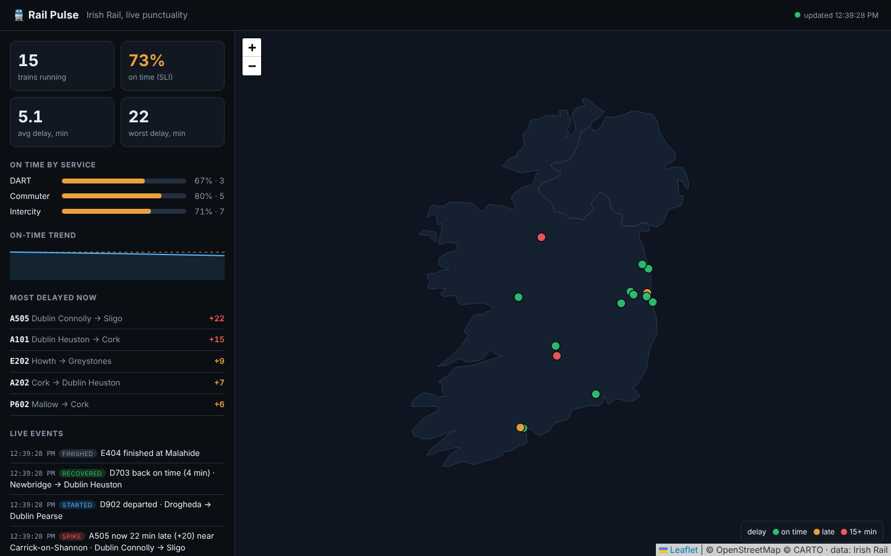

# rail-pulse

**Live punctuality monitoring for Irish Rail.** It polls the public Irish Rail realtime API, tracks every train on a live map, and treats punctuality as an **SRE service-level indicator**, with an 85% SLO, Prometheus alerts and a Grafana dashboard. It's built like a production service: backoff, staleness detection, readiness gating, alert unit tests, and a daily CI check that the live feed hasn't changed shape.




## What you see

- **Live map** of every train, coloured by delay (on time / late / 15+ min), updating in place over Server-Sent Events.
- **SLI tiles**: trains running, % on time, average and worst delay.
- **On time by service** (DART / Commuter / Intercity, each with its own threshold).
- **Live events** detected by diffing consecutive polls: `spike` (delay jumped by 5+ min), `recovered`, `started`, `finished`.
- **Most delayed now** and a 2-hour on-time trend line against the SLO.

## Architecture

```
 Irish Rail realtime API ──(every 30s, min 15s)──► poller ──► parse XML ──► State ──► SSE ──► browser map
   getCurrentTrainsXML        backoff 30→60→…→300s     │            │  diff → events
                              on failure, keep serving  │            ▼
                              last good data            │      /metrics (Prometheus)
                                                        │            │
                                                        │            ▼
                                                        │   Prometheus ──► alert rules (SLO + pipeline)
                                                        │            │           unit-tested with promtool
                                                        │            ▼
                                                        └──► /ready = 503 until fresh data   Grafana dashboard
```

## The SRE parts

| Concept | Implementation |
|---|---|
| **SLI** | `railpulse_on_time_ratio`, the share of running trains within threshold (DART/Commuter 5 min, Intercity 10 min) |
| **SLO + alerting** | `PunctualityBelowSLO` (< 85% over 15m) and `DartPunctualityCritical` (< 70%) |
| **Monitoring the monitor** | `FeedStale` (no good poll for 5 min), `FeedErrorRateHigh`, `RailPulseDown` |
| **Alert unit tests** | `promtool test rules` proves each alert fires (and doesn't fire) when it should, in CI |
| **Graceful degradation** | Upstream down means exponential backoff (capped at 5 min), keep serving the last good data, and a banner in the UI |
| **Readiness** | `/ready` returns 503 until fresh data exists, so Kubernetes never routes users to an empty map |
| **Contract test** | Scheduled CI job parses the **live** feed every weekday morning, catching upstream format changes before users do |
| **Polite client** | Minimum poll interval, a User-Agent, and a single replica with `Recreate` so pollers never double up |

## Run it

```bash
# Live data, full stack (app + Prometheus with alerts + Grafana dashboard)
docker compose up --build
open http://localhost:8000     # live map
open http://localhost:3000     # Grafana: "Rail Pulse" dashboard
open http://localhost:9090/alerts

# Offline (no internet / demo): replays recorded-format snapshots
RAILPULSE_REPLAY=/app/tests/fixtures docker compose up --build

# Without Docker
pip install -r requirements.txt
uvicorn railpulse.app:app --reload
```

On Kubernetes (with k8s-gitops-platform): `kubectl apply -f deploy/k8s.yaml`. It includes a ServiceMonitor, so kube-prometheus-stack scrapes it automatically.

## Tests

- **17 Python tests**: message parsing (late, early, not started, signal locations), position sanity checks, per-service thresholds, event detection across a real 3-poll sequence, backoff timing, minimum interval, readiness, metrics.
- **Alert tests** with `promtool`: stale feed and SLO breach fire after their `for` windows, and a healthy network stays quiet.
- **Live contract test** against the real API (scheduled).

## Notes

- Service type is inferred from the train-code prefix (E = DART, A = Intercity, others = Commuter). That's a heuristic, and the README says so.
- Data: Irish Rail realtime API, public and free, no key needed. This is a personal portfolio project, not affiliated with Irish Rail.

## What I'd add next

- Store history in TimescaleDB for "worst lines this week" reports.
- Station-level SLIs via `getStationDataByCodeXML`.
- A daily AI summary: "Yesterday's punctuality: what went wrong", generated from the metrics.
